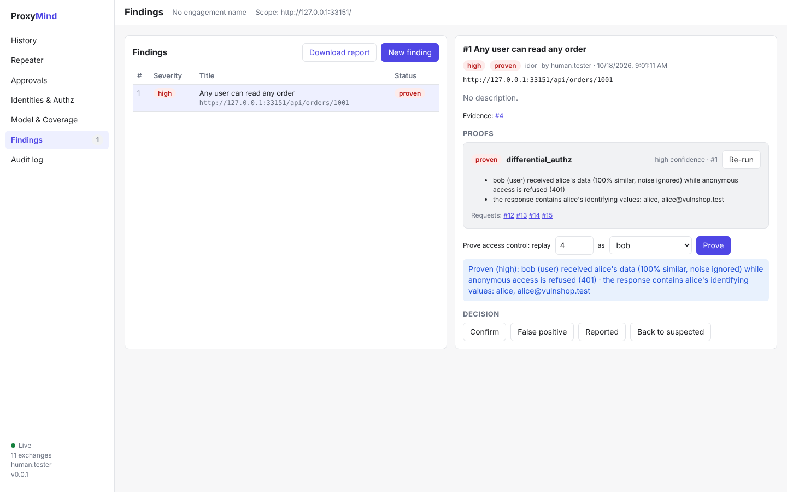

# ProxyMind

**The proxy that thinks.** An open-source, AI-native intercepting proxy for web application pentesting.

Other proxies give AI access to their tools. ProxyMind gives AI an understanding of the app, a memory of the engagement and a requirement to prove every finding, all within rules of engagement the client can audit.

> **Status: pre-alpha.** The engine, the agent interface and the web UI work end to end (see the demo); the proxy speaks HTTP/1.1 and HTTP/2. See [What's done and what's next](docs/plan.md#status).

## Why ProxyMind

| | What it means |
|---|---|
| 🧠 **Live app model** | Builds a map of the app from traffic: objects, IDs, who owns them, and operations. Agents ask questions like "which endpoints accept another user's order ID?" instead of reading raw logs. |
| 👥 **Multi-identity by default** | Keeps several user sessions alive (automatic re-login), replays any request as any user, and compares the responses while ignoring timestamps and tokens. |
| ✅ **No proof, no finding** | Findings count only when ProxyMind proves them itself (differential authz, OAST callbacks, statistical timing, XSS run in a headless browser). Every proof can be re-run with one command. |
| 📒 **Hypothesis ledger & coverage** | Shared memory of what was tested, by whom, and what's still untested, for humans and agents alike. |
| 🛡️ **Rules of engagement as code** | Scope, rate limits, time windows and approvals are enforced by the core, outside the model, with a tamper-evident audit log. |
| 🔌 **Any model, any agent, offline** | MCP server for Claude Code, Cursor or your own agents, including ones running local models (REST API planned). ProxyMind never sends your data to a model itself, and agents see secrets only as placeholders. |

## Try it in two minutes

```bash
cargo build --release
PROXYMIND=./target/release/proxymind bench/demo.sh
```

The script starts **VulnShop** (a small, deliberately vulnerable API built into ProxyMind), browses it through the proxy as three users, captures their sessions, replays requests as other users, and has ProxyMind **prove** the access-control bugs it finds, while correctly refusing to "prove" the protected endpoint. It ends with a benchmark score, an audit-log check and a report (`proxymind report --out report.html`; also Markdown, JSON and SARIF).

Then connect an AI agent ([docs/agents.md](docs/agents.md)) and ask it to find the remaining bugs.

Prefer a container? `docker build -t proxymind .` builds an image with the UI and a headless Chromium for XSS proofs; see [docs/releasing.md](docs/releasing.md#container-image) for running it. Tagged releases ship signed binaries for Linux, macOS and Windows, an SBOM and an image on GHCR.

## The UI

```bash
(cd ui && npm ci && npm run build) && cargo build --release
./target/release/proxymind roe use examples/roe.yaml
./target/release/proxymind ui        # prints a login link: open it in your browser
```

`proxymind ui` starts the proxy (`127.0.0.1:8080`) and the web UI (`127.0.0.1:7777`) together: history with a request/response viewer, a site map and content search (including WebSocket messages, which you can replay on a new connection), an intercept queue (hold, edit, forward or drop requests, responses and WebSocket messages), match-and-replace rules, network settings (upstream proxy, client certificates), a built-in assistant, Repeater (send as any identity, or race a request with the HTTP/2 single-packet attack), passive scanner issues (headers, cookies, CORS, errors, secrets; nothing sent), an active scanner (SQL errors, reflection, open redirect, traversal, SSTI; leads with proof hints), OpenAPI/Swagger import, HAR import and export, Copy as cURL and Paste cURL, a Decoder, Comparer and Sequencer, a crawler (GET only, in scope, skips logout/delete links), Intruder (fuzz marked positions with payload lists, number ranges or built-in lists; anomalies highlighted), approvals for agent actions, identities and authorization checks, the app model and coverage, findings with one-click proofs, and the audit log. Everything updates live.



## Quick start

Requires Rust 1.88+.

```bash
cargo build --release
./target/release/proxymind proxy --listen 127.0.0.1:8080
```

On first run ProxyMind creates a CA at `~/.proxymind/proxymind-ca.pem`. Install it in your browser (or pass it to curl with `--cacert`), then set the browser's proxy to `127.0.0.1:8080`.

```bash
# Try it with curl
curl --cacert ~/.proxymind/proxymind-ca.pem -x http://127.0.0.1:8080 https://example.com/

# See what was recorded
./target/release/proxymind history
./target/release/proxymind show 1
./target/release/proxymind history --json     # machine-readable, for scripts and agents
```

Traffic is stored in `proxymind.pmproj` (a SQLite file) in the current directory. Use `--project <file>` to choose another.

### Apps that ignore proxy settings (transparent mode)

Mobile apps, thick clients and devices often ignore proxy settings. Send their traffic to ProxyMind with DNS (a hosts-file entry pointing the app's host at the proxy machine) or a port redirect, and ProxyMind handles it without any setup:

```bash
./target/release/proxymind proxy --listen 0.0.0.0:8080
# On a Linux gateway, redirect a device's web traffic to the proxy:
sudo iptables -t nat -A PREROUTING -i <device-interface> -p tcp --dport 80  -j REDIRECT --to-port 8080
sudo iptables -t nat -A PREROUTING -i <device-interface> -p tcp --dport 443 -j REDIRECT --to-port 8080
```

Plain HTTP goes to the request's `Host` header. HTTPS without a CONNECT is recognised from the TLS handshake: ProxyMind presents a certificate for the server name the client asked for (SNI), so install the ProxyMind CA on the device, and sends the request to its `Host` (port 443 unless the header says otherwise). Clients that send no server name can't be intercepted this way. A request that would reach ProxyMind itself is refused instead of looping.

### Use it with AI agents (MCP)

```bash
./target/release/proxymind roe use examples/roe.yaml
claude mcp add proxymind -- "$PWD/target/release/proxymind" -p "$PWD/proxymind.pmproj" mcp --actor agent:claude
./target/release/proxymind approvals watch    # approve or deny what the agent asks to do
```

Agents can search history, read exchanges in token-budgeted views with secrets hidden, and send requests through the policy gate. See [docs/agents.md](docs/agents.md).

### Built-in assistant

No agent set up? Use the assistant in the UI (Assistant page) or the terminal. It works with a local model (Ollama, LM Studio, vLLM) by default; Anthropic and OpenAI need `allow_cloud_models: true` in the rules of engagement and an API key in an environment variable (never stored in the project). It acts as `agent:assistant` with the same tools and the same policy gate as any other agent, so scope, approvals, redaction and the audit log all apply.

```bash
./target/release/proxymind assistant set --provider openai --base-url http://127.0.0.1:11434/v1 --model <model>
./target/release/proxymind assistant ask "Which endpoints take an object id, and have we tested them for IDOR?"
```

### Rules of engagement

Describe what's in scope and what each kind of actor may do in a YAML file (see [`examples/roe.yaml`](examples/roe.yaml)), then check it and try requests against it. Nothing is sent when testing.

```bash
./target/release/proxymind roe check examples/roe.yaml
./target/release/proxymind roe test examples/roe.yaml https://app.example.com/profile --actor agent:claude --method POST
# During the engagement dates in the file (2–13 Nov 2026), on weekdays 09:00–18:00 London time:
# NEEDS APPROVAL: POST https://app.example.com/profile as agent:claude (ActiveIntrusive)
# Outside them it prints DENY with the reason.

./target/release/proxymind audit verify     # check the audit log was not tampered with
./target/release/proxymind audit list
```

Match-and-replace rules (add or strip headers, rewrite bodies) live in the project too; edit them in the UI or load a file, and a running proxy picks them up within seconds. See [`examples/match-replace.yaml`](examples/match-replace.yaml).

```bash
./target/release/proxymind rules load examples/match-replace.yaml
./target/release/proxymind rules show
```

Behind a corporate proxy, or testing an API that needs a client certificate? Set an upstream proxy (HTTP or SOCKS5, with optional login and a bypass list) and client certificates per host in the UI's Network page or with a file ([`examples/network.yaml`](examples/network.yaml)). The proxy, Repeater, agents and proofs all use them.

Want your own checks? A passive-check plugin is any program that reads exchanges as JSON lines and prints issues (`proxymind plugin add examples/plugins/jwt-check`); acting plugins use the MCP tools as `plugin:<name>` under stricter rules ([ADR-0014](docs/adr/0014-plugins.md)).

Handing a project to a client or storing it? `proxymind -p client.pmproj project lock --remove` seals it into an encrypted `client.pmlock` (Argon2id passphrase, authenticated encryption); `proxymind project unlock client.pmlock` restores it.

Scripting? `sdk/python` is a dependency-free Python client for the REST API (Apache-2.0): `pip install ./sdk/python`, then `from proxymind import Client`.

Prefer a desktop app? `desktop/` wraps the same UI in a Tauri window with a tray icon (see [ADR-0012](docs/adr/0012-desktop-shell.md) for how to build it).

```bash
./target/release/proxymind network set examples/network.yaml
./target/release/proxymind network show      # the password is never shown
```

Scope rules resist the usual bypass tricks (encoded paths, `../`, `;params`, look-alike hosts, odd IP formats, IPv4-mapped IPv6). The full list is in [`crates/pm-policy/tests/scope_bypass.rs`](crates/pm-policy/tests/scope_bypass.rs).

## Repository layout

```
crates/
  pm-http      raw HTTP/1.x parsing, HTTP/2 text form           ✅ working
  pm-tls       CA and per-host certificates, upstream TLS       ✅ working
  pm-store     SQLite project file and compressed blob store    ✅ working
  pm-proxy     proxy, intercept, match/replace, WebSocket log   ✅ working (HTTP/1.1, HTTP/2)
  pm-cli       the `proxymind` binary                           ✅ working
  pm-demo      VulnShop, a deliberately vulnerable demo API     ✅ working
  pm-policy    scope, ROE, approvals, rate limits, audit chain  ✅ working
  pm-replay    send engine (incl. single-packet parallel sends) ✅ working
  pm-identity  multi-identity sessions, auto re-login           ✅ working
  pm-diff      semantic diff with learned noise masks           ✅ working
  pm-model     live app model: operations, objects, ownership   ✅ working
  pm-ledger    hypotheses and coverage                          ✅ working
  pm-plugin    plugins: per-user registry, passive-check protocol ✅ working
  pm-vault     sealed (encrypted) project files                 ✅ working
  pm-scan      passive scanner checks                           ✅ working
  pm-tools     decoder, comparer, sequencer                     ✅ working
  pm-openapi   OpenAPI 3 / Swagger 2 import                     ✅ working
  pm-crawl     crawler: links, forms, robots.txt, sitemaps      ✅ working
  pm-fuzz      Intruder: positions, attack modes, anomalies     ✅ working
  pm-proof     proof oracles (authz, timing, OAST, reflection)  ✅ working
  pm-browser   headless Chromium for offline XSS proofs         ✅ working
  pm-oast      out-of-band callback listener (HTTP and DNS)     ✅ working
  pm-ai        LLM views, redaction, untrusted tagging          ✅ working
  pm-service   the one service layer every client uses          ✅ working
  pm-api       REST API, live events, serves the web UI         ✅ working
  pm-mcp       MCP server                                       ✅ working
  pm-assistant built-in assistant (local or cloud models)       ✅ working
ui/           web UI (React + TypeScript), built into the binary
sdk/python/   Python client for the REST API (Apache-2.0)
desktop/      desktop app (Tauri 2) around the same web UI
fuzz/         fuzz targets for the parsers (nightly)
docs/          plan, decision records (ADRs), RFCs
examples/      example rules-of-engagement file
schemas/       JSON schemas
bench/         vulnerable target apps for benchmarking
```

## Responsible use

ProxyMind is for testing systems you are authorized to test. The rules-of-engagement features exist to help you stay within that authorization and prove it.

## Contributing

See [CONTRIBUTING.md](CONTRIBUTING.md). Report security issues privately as described in [SECURITY.md](SECURITY.md).

## License

The core is licensed under [AGPL-3.0](LICENSE). SDKs will be Apache-2.0. See [ADR-007](docs/adr/0007-license.md).
