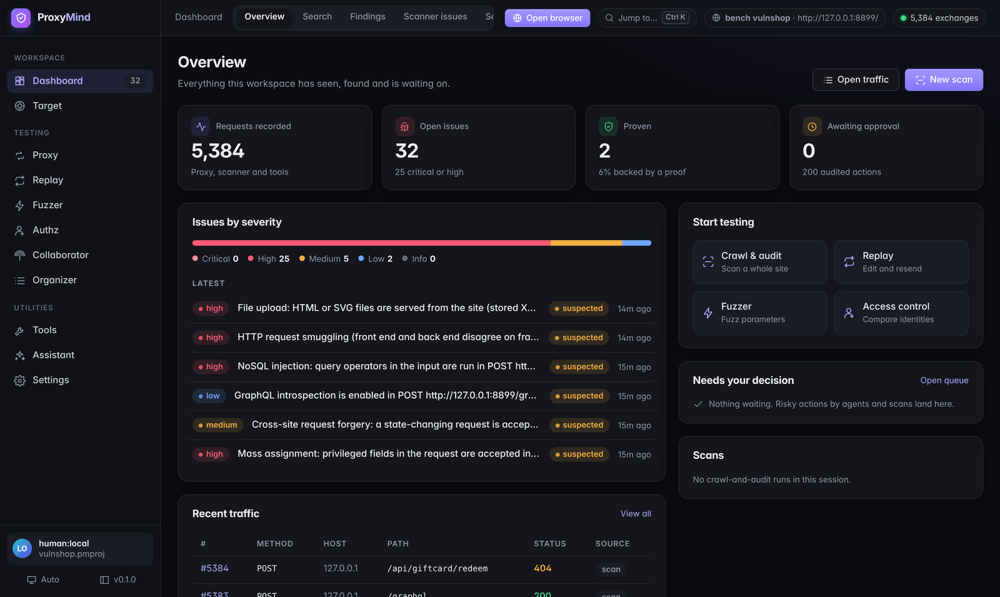
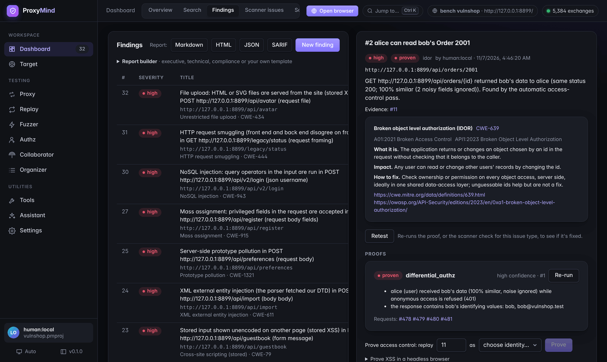
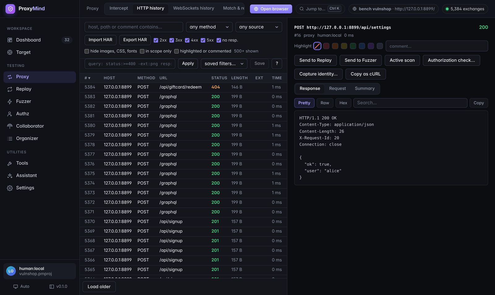
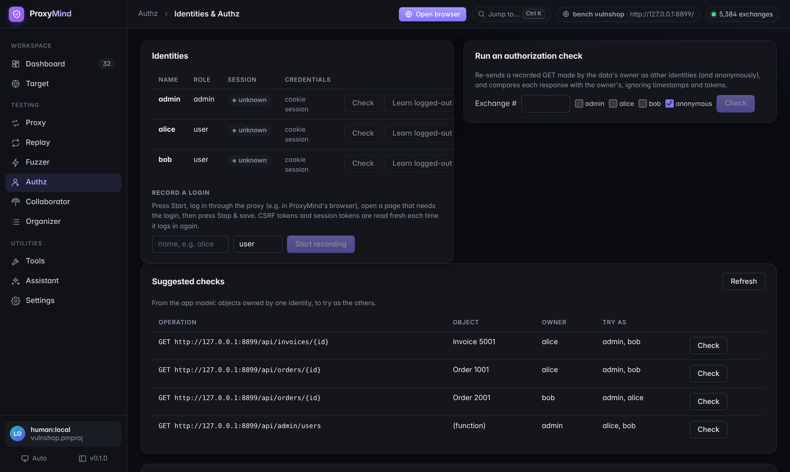

<div align="center">

# 🧠 ProxyMind

### The proxy that thinks.

**An open-source, AI-native intercepting proxy for web application and API pentesting.**
It maps the app, keeps several users logged in, tests what each one can reach,
and **proves** every finding before it counts.

[](https://github.com/ommirkute/ProxyMind/actions/workflows/ci.yml)
[](https://github.com/ommirkute/ProxyMind/releases/latest)
[](LICENSE)
[](https://www.rust-lang.org/)
[](docs/agents.md)

[**Download**](#-download) · [**Quick start**](#-quick-start) · [**Features**](#-features) · [**AI agents**](#-ai-agents) · [**Benchmarks**](#-benchmarks) · [**Docs**](#-documentation)

<br>



</div>

---

## ✨ Why ProxyMind

Other proxies give AI access to their tools. **ProxyMind gives AI an understanding of the app, a memory of the engagement and a requirement to prove every finding**, all inside rules of engagement the client can audit.

| | |
|---|---|
| 🗺️ **Live app model** | Builds a map of the app from traffic: operations, objects, ids and who owns them. Ask *"which endpoints accept another user's order id?"* instead of reading raw logs. |
| 👥 **Multi-identity by default** | Keeps several users logged in (recorded logins, automatic re-login), replays any request as anyone, and compares answers while ignoring timestamps and tokens. |
| ✅ **No proof, no finding** | Findings are proven by ProxyMind itself: differential access checks, out-of-band callbacks, statistical timing, XSS run in a headless browser. Every proof re-runs with one click. |
| 🤖 **Any model, any agent, offline** | A built-in MCP server for Claude Code, Cursor or your own agents, plus a built-in assistant that works with local models. Agents see secrets only as placeholders. |
| 🛡️ **Rules of engagement as code** | Scope, rate limits, time windows and approvals are enforced by the core, outside the model, with a tamper-evident audit log. |
| 🔏 **Verifiable evidence** | Hand the client a signed evidence pack: report, exact traffic behind each finding, proofs, audit chain, scope and a coverage proof. They check it with `proxymind verify`: nothing edited, every request in scope, every finding backed. |
| ⚡ **One fast binary** | Written in Rust. The proxy, web UI, API, scanner and MCP server ship as a single file for Windows, macOS and Linux, plus a desktop app and a container image. |

---

## 📥 Download

Grab the latest build from the **[Releases page](https://github.com/ommirkute/ProxyMind/releases/latest)**. No installer needed: the web UI is built into the binary.

| Platform | Command-line + web UI | Desktop app |
|---|---|---|
| 🪟 **Windows** (x64) | `proxymind-…-x86_64-pc-windows-msvc.zip` → `proxymind.exe` | `.msi` or `-setup.exe` |
| 🍎 **macOS** (Apple silicon) | `proxymind-…-aarch64-apple-darwin.tar.gz` | `.dmg` |
| 🍎 **macOS** (Intel) | `proxymind-…-x86_64-apple-darwin.tar.gz` | |
| 🐧 **Linux** (x64) | `proxymind-…-x86_64-unknown-linux-gnu.tar.gz` | `.AppImage`, `.deb`, `.rpm` |
| 🐧 **Linux** (ARM64) | `proxymind-…-aarch64-unknown-linux-gnu.tar.gz` | |
| 🐳 **Docker** | `docker pull ghcr.io/ommirkute/proxymind` | |

Every release comes with `SHA256SUMS`, an SBOM and signed build provenance ([how to verify](docs/releasing.md#verifying-a-download)).

> [!NOTE]
> The builds aren't code-signed yet. On **Windows**, SmartScreen may warn on first run: choose *More info → Run anyway*. On **macOS**, run `xattr -d com.apple.quarantine proxymind` once (or right-click the app → *Open*).

---

## 🚀 Quick start

**1. Start it**

```bash
# Windows: .\proxymind.exe ui     macOS / Linux:
./proxymind ui
```

This starts the proxy on `127.0.0.1:8080` and the web UI on `127.0.0.1:7777`, and prints a login link. Open it in your browser.

**2. Send traffic through it.** The easiest way is the **Open browser** button: a separate Chromium already set up to use the proxy and trust its certificate. To use your own browser instead, follow the steps on the *Proxy → Proxy setup* page (CA download and per-OS steps).

**3. Set your scope.** Under *Target → Scope & rules*, add the hosts you're allowed to test. Nothing outside the scope is ever sent by ProxyMind's tools.

**Want to see it find bugs right away?** ProxyMind includes **VulnShop**, a small, deliberately vulnerable shop for practice:

```bash
./proxymind demo-target                       # VulnShop on http://127.0.0.1:8899 (local only)
PROXYMIND=./proxymind bench/demo.sh           # or the full guided demo (from a source checkout)
```

The demo browses VulnShop as three users, replays requests as the others, **proves** the access-control bugs it finds, correctly refuses to "prove" the protected endpoint, and ends with a report.

---

## 🧰 Features

<table>
<tr>
<td width="50%" valign="top">

### 🔁 Proxy & history
- HTTP/1.1, HTTP/2 and WebSockets, **byte-exact**: nothing is changed unless you ask
- Intercept requests, responses and WebSocket messages; edit, forward or drop
- Match & replace rules, with presets (unhide fields, strip security headers…)
- History with a query language: `status:>=400 -ext:png resp:"error"`
- Site map, global search, highlights and comments
- Transparent mode for apps that ignore proxy settings, extra listeners, upstream proxies (HTTP/SOCKS5) and client certificates
- HAR import/export, *Copy as cURL / Python / JS / PowerShell*

</td>
<td width="50%" valign="top">

### 🎯 Replay & Fuzzer
- Replay tabs with an inspector, history, HTTP/2 pseudo-headers
- Send as any identity; send a group of tabs in sequence or **at the same moment**
- Race conditions with the HTTP/2 **single-packet attack**
- Fuzzer: marked positions, attack modes, payload lists, number ranges, processing rules, recursive grep, anomaly highlighting
- Collaborator: out-of-band payloads over **HTTP, DNS and SMTP**; a callback that arrives hours after a scan still becomes a finding

</td>
</tr>
<tr>
<td valign="top">

### 🔍 Scanner
- **Passive** (nothing sent): headers, cookies, CORS, errors, secrets, comments
- **Active**: SQL injection (error, boolean, time, out-of-band), command injection, SSTI, XSS (reflected, stored, DOM), path traversal, open redirect, XXE, SSRF, NoSQL/LDAP/XPath, CRLF, Host header, CORS, auth bypass, hidden parameters, JWT, GraphQL, web cache poisoning and deception, mass assignment, prototype pollution, OAuth, deserialization
- **With approval**: request smuggling, file upload, race conditions, ReDoS and cross-user writes
- Parameters a page reads though nothing sends them are found, then scanned like any other input
- Crawl-and-audit, scan profiles, schedules, pause and resume
- Your own checks in YAML, no code needed

</td>
<td valign="top">

### 👥 Access control
- Identities with cookies, tokens or **recorded login sequences**
- Session-expiry detection and automatic re-login
- One-click authorization checks: the owner's request replayed as other users and anonymously
- Suggested checks from the app model: every object, who owns it, who to try
- IDOR/BOLA and broken function-level authorization over REST **and GraphQL**

</td>
</tr>
<tr>
<td valign="top">

### 🗺️ Recon
- Crawler, including a browser-driven crawl for JavaScript apps
- **JavaScript endpoint mining**: API routes and parameters the app's scripts mention, including ones no page links to
- **Passive recon**: DNS records (SPF, DMARC, CAA, dangling CNAMEs) and Wayback Machine URL history for hosts in scope, without sending anything to the target
- Content discovery with soft-404 detection, robots.txt folders and other API versions
- OpenAPI/Swagger and GraphQL (introspection) import
- Engagement tools: comments, scripts, references, parameter analysis, CSRF and clickjacking proof pages

</td>
<td valign="top">

### 📊 Proof & reporting
- Proof oracles: differential authz, timing, OAST, XSS in headless Chromium
- **Coverage proof**: every operation × vulnerability class, who tested it and how (scanner checks, authz checks, proofs), and what nobody tested
- **Signed evidence packs** the client verifies themselves (`proxymind evidence`, `proxymind verify`)
- **Authorization matrix**: every endpoint as every role, as one grid; IDOR, missing function-level checks and missing login flagged and proven automatically
- **What changed since the last test**: model snapshots and a diff that points the retest at new and changed endpoints
- **Findings as CI regression tests**: every proven finding exports as a test developers run against staging until it's fixed (`proxymind regress run`, JUnit output)
- Issue library with CWE/OWASP mapping and fix advice
- Reports in **HTML, Markdown, JSON and SARIF**; executive, technical, compliance or your own template
- Sealed projects: encrypt a project file to hand it over safely

</td>
</tr>
</table>



<details>
<summary><b>More screenshots</b></summary>

**HTTP history**, with filters, the query language and a request/response viewer


**Identities & authorization checks**, with suggestions from the app model


</details>

---

## 🤖 AI agents

Connect any MCP-capable agent. It works through the same policy gate as everyone else: scope, approvals, redaction and the audit log all apply.

```bash
proxymind roe use examples/roe.yaml        # what's in scope and what agents may do
claude mcp add proxymind -- proxymind -p "$PWD/proxymind.pmproj" mcp --actor agent:claude
proxymind approvals watch                  # approve or deny what the agent asks to do
```

Agents can search history, read exchanges in token-budgeted views with secrets hidden, query the app model, send requests, run scans and proofs, and record hypotheses. **Skills** give them testing playbooks to follow (access-control sweep, SSRF hunt, triage, JS recon, auth review, JWT audit, races, uploads), as MCP prompts or tools, and you can add your own. See [docs/agents.md](docs/agents.md).

**AI scan:** let the agent run a whole assessment on its own, from recon to chained proofs and a report, with a step and time budget, a live activity log and a Stop button. Message it while it runs to change its focus or ask why it did something. It draws the **attack paths** it finds as a graph, tests **business logic** (prices, coupons, limits, workflow order) that scanners can't judge, and ProxyMind **retests every finding** it reports before you read it. A **cost meter** shows tokens and dollars with an optional budget, a **prompt-injection guard** flags target text that tries to instruct the model, and **Explain & fix** writes a developer-ready explanation and code fix for any finding. Local models get presets (Ollama, LM Studio, llama.cpp, vLLM), a model picker and a compact tool set. The lead agent can hand focused tasks to **parallel worker agents**, scans **remember** what earlier scans of a host learned and **learn from your verdicts** (no repeated false positives), and **Worth testing** ranks recorded requests by what to try first. It works within the rules of engagement like any agent: risky steps wait for your approval.

**No agent?** Use the built-in **Assistant** (UI or terminal). It runs on a local model by default (Ollama, LM Studio, vLLM); cloud models need an explicit opt-in in the rules of engagement.

```bash
proxymind assistant set --provider openai --base-url http://127.0.0.1:11434/v1 --model <model>
proxymind assistant ask "Which endpoints take an object id, and have we tested them for IDOR?"
```

---

## 🛡️ Rules of engagement

Describe the engagement in YAML ([example](examples/roe.yaml)): scope, dates and hours, rate limits, and what each kind of actor (person, agent, plugin) may do at each risk tier. ProxyMind enforces it in the core, not in a prompt.

```bash
proxymind roe check examples/roe.yaml
proxymind roe test examples/roe.yaml https://app.example.com/profile --actor agent:claude --method POST
# NEEDS APPROVAL: POST https://app.example.com/profile as agent:claude (ActiveIntrusive)

proxymind audit verify      # the audit log is hash-chained: tampering shows
```

Scope matching resists the usual bypass tricks: encoded paths, `../`, `;params`, look-alike hosts, odd IP formats and IPv4-mapped IPv6 ([tests](crates/pm-policy/tests/scope_bypass.rs)).

---

## 📈 Benchmarks

The automatic pass (`proxymind bench auto`) runs against deliberately vulnerable apps with known bugs, and is scored against their published ground truth. **No false positives on any of them.**

| App | Found | False positives |
|---|---|---|
| [OWASP Juice Shop](https://github.com/juice-shop/juice-shop) | **9 / 9** | 0 |
| [VAmPI](https://github.com/erev0s/VAmPI) | **8 / 8** | 0 |
| VulnShop (built in) | **33 / 38** | 0 |

VulnShop's remaining five are on pages nothing links to or describes, or need a code the app never reveals: that's what agents are for. Details and how to run it yourself: [bench/README.md](bench/README.md).

---

## 🧩 Extend it

- **Plugins**: any program that speaks JSON lines. Passive checks, active checks and UI panels, run sandboxed, optionally signed (Ed25519). [Examples](examples/plugins) · [ADR-0014](docs/adr/0014-plugins.md)
- **Custom checks**: declarative YAML scanner checks, edited in the UI.
- **SDKs**: dependency-free REST clients for **Python** (`sdk/python`) and **TypeScript** (`sdk/typescript`), Apache-2.0.
- **REST API** with live events: everything the UI does, you can script.

---

## 🛠️ Build from source

Requires **Rust 1.89+** and **Node 20+** (for the web UI).

```bash
git clone https://github.com/ommirkute/ProxyMind && cd ProxyMind
(cd ui && npm ci && npm run build)      # the UI gets embedded in the binary
cargo build --release
./target/release/proxymind ui
```

Other ways to run it:

- **Docker**: `docker build -t proxymind .` ([running it](docs/releasing.md#container-image); includes Chromium for XSS proofs)
- **Desktop app**: `desktop/` wraps the same UI in a Tauri window with a tray icon ([ADR-0012](docs/adr/0012-desktop-shell.md))
- **Headless / CI**: every feature is also a CLI command (`proxymind --help`) with `--json` output

<details>
<summary><b>Architecture</b></summary>

One service layer that every client uses (UI, REST API, MCP, CLI), and every action goes through the policy gate ([ADR-0005](docs/adr/0005-single-service-layer.md)).

```
crates/
  pm-http      raw HTTP/1.x parsing, HTTP/2 text form (no I/O, fuzzed)
  pm-tls       CA and per-host certificates, upstream TLS
  pm-proxy     proxy, intercept, match/replace, WebSockets
  pm-store     SQLite project file and compressed blob store
  pm-policy    scope, rules of engagement, approvals, rate limits, audit chain
  pm-replay    send engine (incl. single-packet parallel sends)
  pm-identity  multi-identity sessions, recorded logins, re-login
  pm-model     live app model: operations, objects, ownership
  pm-diff      semantic diff with learned noise masks
  pm-scan      passive and active scanner checks
  pm-proof     proof oracles (authz, timing, OAST, reflection)
  pm-oast      out-of-band listener (HTTP, DNS, SMTP)
  pm-browser   headless Chromium for XSS proofs and crawling
  pm-crawl     crawler and content discovery
  pm-fuzz      Fuzzer
  pm-openapi   OpenAPI 3 / Swagger 2 import
  pm-graphql   GraphQL introspection import
  pm-ledger    hypotheses and coverage
  pm-plugin    plugins: protocols, sandbox, signatures
  pm-vault     sealed (encrypted) project files
  pm-ai        model views, redaction, untrusted-content tagging
  pm-service   the one service layer
  pm-api       REST API and live events; serves the web UI
  pm-mcp       MCP server
  pm-assistant built-in assistant
  pm-cli       the `proxymind` binary
  pm-demo      VulnShop
ui/            web UI (React + TypeScript)
desktop/       desktop app (Tauri 2)
sdk/           Python and TypeScript clients
bench/         benchmark apps and ground truth
fuzz/          fuzz targets for the parsers
```

</details>

---

## 📚 Documentation

| | |
|---|---|
| [docs/agents.md](docs/agents.md) | Connecting AI agents (MCP) |
| [docs/plan.md](docs/plan.md) | Roadmap and status |
| [docs/adr/](docs/adr/) | Architecture decision records |
| [docs/scanner-matrix.md](docs/scanner-matrix.md) | Scanner coverage, check by check |
| [docs/releasing.md](docs/releasing.md) | Releases, verifying downloads, Docker |
| [bench/README.md](bench/README.md) | Benchmarks and how to run them |

---

## ⚖️ Responsible use

ProxyMind is for testing systems **you are authorized to test**. The rules-of-engagement features exist to help you stay within that authorization and prove it. VulnShop is deliberately vulnerable: run it on your own machine only.

## 🤝 Contributing

Contributions are welcome. See [CONTRIBUTING.md](CONTRIBUTING.md), and report security issues privately as described in [SECURITY.md](SECURITY.md).

## 📄 License

The core is [AGPL-3.0](LICENSE). The SDKs are Apache-2.0. See [ADR-0007](docs/adr/0007-license.md).

<div align="center">
<br>
<sub>Built with 🦀 Rust · If ProxyMind helps you, consider giving it a ⭐</sub>
</div>
